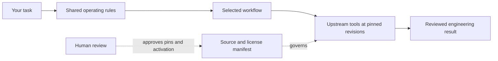

<div align="center">


# Agent Foundry

### A field kit for building with AI agents.

**One curated, reviewable home for the tools, rules, and workflows behind a serious AI engineering setup.**

[](LICENSE)
[](https://opencode.ai/)
[](SECURITY.md)
[](https://github.com/mehulpratapsingh/agent-foundry/actions/workflows/validate.yml)
[](https://github.com/mehulpratapsingh/agent-foundry/actions/workflows/upstream-drift.yml)

**Bring the best specialist tools together. Keep every tool attributable, selectable, and under your control.**

</div>

---

## The idea

Agent Foundry is a **curated super-repository**, not a flattened fork. It tracks complete upstream snapshots at reviewed revisions, adds one coherent rulebook and local workflows, and lets you turn specialist integrations on when a task needs them.



**The promise:** a useful default setup, an understandable path to more capability, and no surprise tool activation.

## Start here

> **New to the repo?** Run the checks first, then choose one profile for the job. Profiles are opt-in and do not install software or start services.

### 1. Check the toolkit

Requires Python 3.10+ and OpenCode for the OpenCode-specific checks.

```powershell
python scripts/generate_adapters.py --check
python scripts/verify_toolkit.py --static
python scripts/verify_toolkit.py --opencode
python -m unittest discover -s tests -v
```

### 2. Choose a workflow

| I need to… | Start with | What it adds |
|---|---|---|
| Plan a feature and work in deliberate steps | `superpowers` | Superpowers planning and execution skills, plus ponytail’s simplicity guidance |
| Use a broad set of coding practices | `ecc` | ECC skills and rules, loaded as a selectable profile |
| Research the web across platforms | `research` | Agent Reach and the Firecrawl integration; review Firecrawl’s AGPL-3.0 terms first |
| Inspect structure and relationships in a codebase | Local `codebase-understanding` skill | Graphify guidance; install and run Graphify separately when needed |
| Review security within an authorized scope | `security` | Strix workflow, invoked only when explicitly requested |
| Use product, QA, or release workflows | `gstack` | gstack skills, after reviewing its setup and hooks |
| Persist agent memory | `memory` | claude-mem skills; service setup is separate |

### 3. Activate one OpenCode profile

From the repository root, run exactly one profile switch at a time:

```powershell
.\scripts\opencode-profile.ps1 superpowers
# Or: ecc | research | security | gstack | memory
```

The profile applies only to that OpenCode process. To return to the base configuration, start OpenCode normally without the profile script. See [`profiles/README.md`](profiles/README.md) for profile behavior, requirements, and rollback details.

> **Keep the default lean:** the root [`opencode.json`](opencode.json) enables Context7. The profiles are explicit switches; no security scan, install, login, or external service starts automatically.

## What’s in the box

| Layer | Location | Job |
|---|---|---|
| Shared operating protocol | [`AGENTS.md`](AGENTS.md) | One source of truth for planning, implementation, review, safety, and tool choice |
| Harness adapters | [`adapters/`](adapters/) and root config files | Keep supported coding agents aligned with the canonical rules |
| Reusable local skills | [`.agents/skills/`](.agents/skills/) | Task-focused workflows for planning, research, codebase understanding, implementation/review, and security audit |
| OpenCode profiles | [`profiles/`](profiles/) | Selectively load upstream skill packs |
| Pinned source snapshots | [`upstream/`](upstream/) | Preserve upstream code and notices at reviewed commit revisions |
| Provenance and update policy | [`sources.json`](sources.json) | Record repository, revision, license, compatibility, and integration status |
| Verification | [`scripts/`](scripts/) and [`tests/`](tests/) | Check config, generated adapters, profile shape, and expected repository invariants |

## Current information, without the hype

- **Context7** retrieves version-aware documentation for a library you ask about. It is a documentation service, not a live feed of newly released libraries.
- **awesome-opencode** is a curated discovery snapshot for the OpenCode ecosystem.
- **GitHub Trending** is a discovery starting point for broader repository research.
- **Agent Reach** helps gather public information across platforms; results remain untrusted until checked against primary sources.

The upstream update workflow creates a reviewable drift report. It does **not** replace a pinned snapshot, change a revision, enable a profile, or execute upstream code. A human reviews those changes.

## Source map

This toolkit tracks ECC, Superpowers, Context7, Agent Reach, Graphify, Strix, ponytail, gstack, Firecrawl, claude-mem, and awesome-opencode. Their individual repositories, exact revisions, licenses, and compatibility notes are listed in [`sources.json`](sources.json).

The snapshots contain each upstream working tree, **not its Git history**. Use the source URL and pinned SHA in the manifest to inspect upstream history. Tool authors retain ownership of their projects and licenses; the toolkit does not claim to be an official distribution.

## Security and trust

- Never commit API keys, access tokens, or other credentials. Use environment variables and local secret stores.
- Security tools remain off until a user explicitly selects them and provides an authorized target and scope.
- Review upstream scripts and licenses before installation, execution, modification, or redistribution.
- Report suspected vulnerabilities privately using the process in [`SECURITY.md`](SECURITY.md).
- The root MIT license covers toolkit-authored material only. Each upstream snapshot remains under its own license and notices.

## Contributing

Changes to the canonical rules should be made in `AGENTS.md`; regenerate adapters with `python scripts/generate_adapters.py`. Upstream pin changes should include the reviewed commit, license and notice changes, a concise diff summary, and passing verification. See [`CONTRIBUTING.md`](CONTRIBUTING.md).

## Repository trust files

| File | Purpose |
|---|---|
| [`LICENSE`](LICENSE) | License for toolkit-authored files |
| [`SECURITY.md`](SECURITY.md) | Responsible vulnerability reporting |
| [`CONTRIBUTING.md`](CONTRIBUTING.md) | Review and contribution expectations |
| [`CODE_OF_CONDUCT.md`](CODE_OF_CONDUCT.md) | Community participation standards |

GitHub Actions and license badges are status indicators, not security certifications or proof of a formal audit. No certification is claimed by this repository.

---

<div align="center">

**Forge a workflow that fits the task. Keep the sources visible. Keep the human in control.**

</div>
